## 1.Diseño e Implementación de un Sistema de Base de Datos relacional para la Gestión Operativa y Control de Inventarios de un Taller Mecánico Automotriz

## 2. CONTEXTO DEL PROBLEMA

El taller mecánico automotriz enfrenta una alta demanda de servicios que se gestiona mediante registros manuales y hojas de cálculo aisladas. Esta falta de digitalización genera duplicidad de datos, escasa trazabilidad en las reparaciones, descontrol en el inventario de repuestos y errores frecuentes en la facturación.

Esta problemática afecta directamente a los clientes con tiempos de espera prolongados, a los mecánicos con desorganización operativa, y a la administración con pérdida de control financiero y de stock. Para solucionar esto, es fundamental gestionar de manera estructurada e interrelacionada la información de clientes, vehículos, mecánicos, órdenes de trabajo, servicios, repuestos y pagos, garantizando la integridad de los datos y mejorando la eficiencia general del taller.

## 3. OBJETIVOS

### 3.1. Objetivo General

Diseñar e implementar una base de datos relacional para la gestión integral de un taller mecánico automotriz mediante el modelado Entidad-Relación y su esquema relacional, con el fin de optimizar el control de clientes, vehículos, órdenes de trabajo, inventario de repuestos y facturación.

### 3.2. Objetivos Específicos

- Elaborar el modelado conceptual y lógico de la base de datos mediante el diagrama Entidad-Relación (notación Chen) y el esquema relacional, identificando con precisión las entidades, atributos, claves primarias, claves foráneas y cardinalidades requeridas para el taller mecánico.
- Implementar la base de datos en MySQL mediante sentencias DDL y DML, creando 12 tablas con sus restricciones de integridad (PRIMARY KEY, FOREIGN KEY, NOT NULL, UNIQUE, DEFAULT y CHECK) y cargando datos de ejemplo coherentes, y validar su funcionamiento con cinco consultas formuladas en álgebra relacional y traducidas a SQL que empleen distintos operadores (selección, proyección, reunión natural, diferencia y división).

## 4. MODELOS CONCEPTUALES DE BASES DE DATOS

### 4.1. Modelo Entidad-Relación


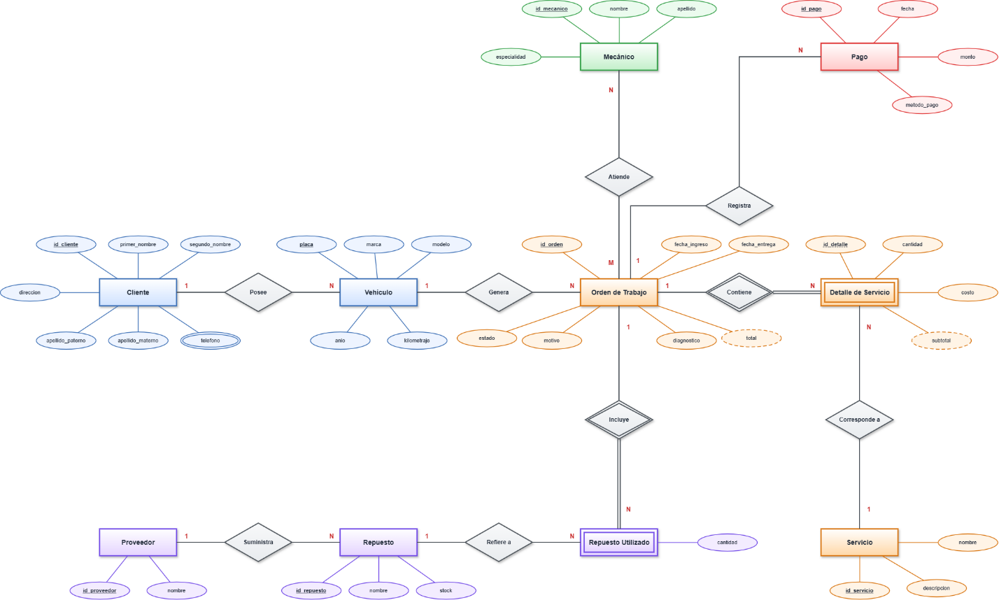

*Figura 1. Diagrama Entidad-Relación del Sistema de Base de Datos relacional para la Gestión Operativa y Control de Inventarios de un Taller Mecánico Automotriz*

### 4.2. Modelo Relacional

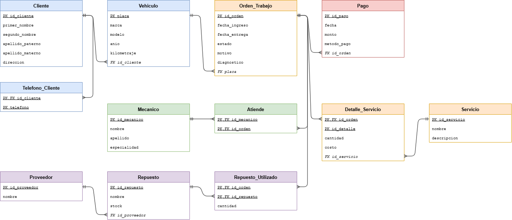


*Figura 2. Modelo relacional del Sistema de Base de Datos relacional para la Gestión Operativa y Control de Inventarios de un Taller Mecánico Automotriz*

---

## CÓDIGO SQL

### 5.1. Creación de Tablas (DDL)

Presentar el código SQL correspondiente a la creación de al menos 3 tablas representativas del sistema. El código debe incluir:

- Sentencia CREATE TABLE con nombre de tabla en mayusculas o siguiendo la convencion del equipo.
- Definicion de columnas con tipos de datos apropiados (INT, VARCHAR, DATE, DECIMAL, etc.).
- Restricciones: PRIMARY KEY, NOT NULL, UNIQUE, DEFAULT, CHECK.
- Claves foraneas con FOREIGN KEY ... REFERENCES para mantener la integridad referencial.

```sql
-- SISTEMA DE TALLER MECANICO
DROP DATABASE IF EXISTS taller_mecanico;
CREATE DATABASE taller_mecanico CHARACTER SET utf8mb4 COLLATE utf8mb4_unicode_ci;
USE taller_mecanico;

-- ---------------------------------------------------------------------
CREATE TABLE CLIENTE (
  id_cliente       INT         NOT NULL AUTO_INCREMENT,
  primer_nombre    VARCHAR(50) NOT NULL,
  segundo_nombre   VARCHAR(50),
  apellido_paterno VARCHAR(50) NOT NULL,
  apellido_materno VARCHAR(50),
  direccion        VARCHAR(150),
  PRIMARY KEY (id_cliente)
);

-- Atributo multivalor "telefono" del E-R
CREATE TABLE TELEFONO_CLIENTE (
  id_cliente INT         NOT NULL,
  telefono   VARCHAR(15) NOT NULL,
  PRIMARY KEY (id_cliente, telefono),
  FOREIGN KEY (id_cliente) REFERENCES CLIENTE(id_cliente)
    ON DELETE CASCADE ON UPDATE CASCADE
);

-- ---------------------------------------------------------------------
CREATE TABLE VEHICULO (
  placa       VARCHAR(10) NOT NULL,
  marca       VARCHAR(50) NOT NULL,
  modelo      VARCHAR(50) NOT NULL,
  anio        INT         NOT NULL,
  kilometraje INT         NOT NULL DEFAULT 0,
  id_cliente  INT         NOT NULL,
  PRIMARY KEY (placa),
  CONSTRAINT ck_vehiculo_anio CHECK (anio BETWEEN 1950 AND 2100),
  CONSTRAINT ck_vehiculo_km   CHECK (kilometraje >= 0),
  FOREIGN KEY (id_cliente) REFERENCES CLIENTE(id_cliente)
    ON DELETE RESTRICT ON UPDATE CASCADE
);

-- ---------------------------------------------------------------------
CREATE TABLE MECANICO (
  id_mecanico  INT         NOT NULL AUTO_INCREMENT,
  nombre       VARCHAR(50) NOT NULL,
  apellido     VARCHAR(50) NOT NULL,
  especialidad VARCHAR(80),
  PRIMARY KEY (id_mecanico)
);

-- ---------------------------------------------------------------------
CREATE TABLE SERVICIO (
  id_servicio INT         NOT NULL AUTO_INCREMENT,
  nombre      VARCHAR(80) NOT NULL,
  descripcion VARCHAR(200),
  PRIMARY KEY (id_servicio),
  UNIQUE (nombre)
);

-- ---------------------------------------------------------------------
CREATE TABLE PROVEEDOR (
  id_proveedor INT         NOT NULL AUTO_INCREMENT,
  nombre       VARCHAR(80) NOT NULL,
  PRIMARY KEY (id_proveedor),
  UNIQUE (nombre)
);

CREATE TABLE REPUESTO (
  id_repuesto  INT         NOT NULL AUTO_INCREMENT,
  nombre       VARCHAR(80) NOT NULL,
  stock        INT         NOT NULL DEFAULT 0,
  id_proveedor INT         NOT NULL,
  PRIMARY KEY (id_repuesto),
  CONSTRAINT ck_repuesto_stock CHECK (stock >= 0),
  FOREIGN KEY (id_proveedor) REFERENCES PROVEEDOR(id_proveedor)
    ON DELETE RESTRICT ON UPDATE CASCADE
);

-- ---------------------------------------------------------------------
CREATE TABLE ORDEN_TRABAJO (
  id_orden      INT          NOT NULL AUTO_INCREMENT,
  fecha_ingreso DATE         NOT NULL DEFAULT (CURRENT_DATE),
  fecha_entrega DATE,
  estado        VARCHAR(20)  NOT NULL DEFAULT 'PENDIENTE',
  motivo        VARCHAR(200) NOT NULL,
  diagnostico   VARCHAR(300),
  placa         VARCHAR(10)  NOT NULL,
  PRIMARY KEY (id_orden),
  CONSTRAINT ck_orden_estado
    CHECK (estado IN ('PENDIENTE', 'EN_PROCESO', 'FINALIZADO', 'ENTREGADO')),
  CONSTRAINT ck_orden_fechas
    CHECK (fecha_entrega IS NULL OR fecha_entrega >= fecha_ingreso),
  FOREIGN KEY (placa) REFERENCES VEHICULO(placa)
    ON DELETE RESTRICT ON UPDATE CASCADE
);

-- Relacion M:N MECANICO - ORDEN_TRABAJO ("Atiende")
CREATE TABLE ATIENDE (
  id_mecanico INT NOT NULL,
  id_orden    INT NOT NULL,
  PRIMARY KEY (id_mecanico, id_orden),
  FOREIGN KEY (id_mecanico) REFERENCES MECANICO(id_mecanico)
    ON DELETE RESTRICT ON UPDATE CASCADE,
  FOREIGN KEY (id_orden) REFERENCES ORDEN_TRABAJO(id_orden)
    ON DELETE CASCADE ON UPDATE CASCADE
);

-- ---------------------------------------------------------------------
CREATE TABLE PAGO (
  id_pago     INT           NOT NULL AUTO_INCREMENT,
  fecha       DATE          NOT NULL,
  monto       DECIMAL(10,2) NOT NULL,
  metodo_pago VARCHAR(20)   NOT NULL DEFAULT 'EFECTIVO',
  id_orden    INT           NOT NULL,
  PRIMARY KEY (id_pago),
  CONSTRAINT ck_pago_monto CHECK (monto > 0),
  CONSTRAINT ck_pago_metodo
    CHECK (metodo_pago IN ('EFECTIVO', 'TARJETA', 'TRANSFERENCIA')),
  FOREIGN KEY (id_orden) REFERENCES ORDEN_TRABAJO(id_orden)
    ON DELETE RESTRICT ON UPDATE CASCADE
);

-- Entidad debil de ORDEN_TRABAJO
CREATE TABLE DETALLE_SERVICIO (
  id_orden    INT           NOT NULL,
  id_detalle  INT           NOT NULL,
  cantidad    INT           NOT NULL DEFAULT 1,
  costo       DECIMAL(10,2) NOT NULL,
  id_servicio INT           NOT NULL,
  PRIMARY KEY (id_orden, id_detalle),
  CONSTRAINT ck_detalle_cantidad CHECK (cantidad > 0),
  CONSTRAINT ck_detalle_costo    CHECK (costo >= 0),
  FOREIGN KEY (id_orden) REFERENCES ORDEN_TRABAJO(id_orden)
    ON DELETE CASCADE ON UPDATE CASCADE,
  FOREIGN KEY (id_servicio) REFERENCES SERVICIO(id_servicio)
    ON DELETE RESTRICT ON UPDATE CASCADE
);

-- Entidad debil: repuestos usados en cada orden
CREATE TABLE REPUESTO_UTILIZADO (
  id_orden    INT NOT NULL,
  id_repuesto INT NOT NULL,
  cantidad    INT NOT NULL DEFAULT 1,
  PRIMARY KEY (id_orden, id_repuesto),
  CONSTRAINT ck_repuesto_util_cantidad CHECK (cantidad > 0),
  FOREIGN KEY (id_orden) REFERENCES ORDEN_TRABAJO(id_orden)
    ON DELETE CASCADE ON UPDATE CASCADE,
  FOREIGN KEY (id_repuesto) REFERENCES REPUESTO(id_repuesto)
    ON DELETE RESTRICT ON UPDATE CASCADE
);
```

### 5.2. Inserción de Datos (DML)

Incluir sentencias INSERT INTO con datos de ejemplo representativos para al menos 3 tablas. Los datos deben ser coherentes entre sí (las claves foráneas deben corresponder a registros existentes) y deben cubrir casos variados para que las consultas posteriores sean significativas.

```sql
INSERT INTO CLIENTE (primer_nombre, segundo_nombre, apellido_paterno, apellido_materno, direccion)
VALUES
  ('Juan', 'Carlos', 'Pérez', 'Ramírez', 'Av. Universitaria 12-45'),
  ('María', NULL, 'González', 'Torres', 'Calle Bolívar y Sucre'),
  ('Luis', 'Fernando', 'Jiménez', 'Castillo', 'Barrio San Sebastián, Calle Lourdes'),
  ('Ana', 'Lucía', 'Vargas', 'Mora', 'Av. Manuel Agustín Aguirre 8-20'),
  ('Pedro', NULL, 'Ordóñez', 'Salinas', 'Ciudadela Zamora Huayco'),
  ('Carla', 'Estefanía', 'Cueva', 'Armijos', 'Av. Orillas del Zamora 3-15');

INSERT INTO VEHICULO (placa, marca, modelo, anio, kilometraje, id_cliente)
VALUES
  ('LBA-1234', 'Chevrolet', 'Sail', 2018, 85000, 1),
  ('LCD-5678', 'Toyota', 'Hilux', 2020, 60000, 2),
  ('LAB-9012', 'Kia', 'Rio', 2016, 120500, 3),
  ('LEF-3456', 'Hyundai', 'Tucson', 2021, 35000, 4),
  ('LGH-7890', 'Nissan', 'Frontier', 2019, 98000, 5),
  ('LIJ-2468', 'Mazda', 'CX-5', 2022, 15000, 1);

INSERT INTO MECANICO (nombre, apellido, especialidad)
VALUES
  ('Carlos', 'Mendoza', 'Motor'),
  ('Jorge', 'Salazar', 'Frenos y suspensión'),
  ('Diego', 'Paredes', 'Sistema eléctrico'),
  ('Marco', 'Villavicencio', 'Transmisión'),
  ('Andrea', 'Loaiza', 'Diagnóstico computarizado');
```

***Recomendacion:*** *Insertar minimo 5 registros por tabla para que las consultas de algebra relacional tengan resultados significativos y demostrables.*

---

## CONSULTA DE ÁLGEBRA RELACIONAL Y TRADUCIR A SQL

***Operadores del algebra relacional a utilizar:*** *Seleccion (sigma), Proyeccion (pi), Union, Interseccion, Diferencia, Producto cartesiano, Reunion natural (JOIN), Division. Cada consulta debe usar al menos un operador diferente.*

### Consulta 1

Obtener los nombres de los clientes y los datos de sus vehículos que tengan un kilometraje superior a 80.000 km y que hayan ingresado al taller durante el año 2026.

**Álgebra Relacional:**

```
π primer_nombre, apellido_paterno, placa, marca, modelo, anio, kilometraje (σ kilometraje > 80000 and fecha_ingreso.year == 2026 (cliente ⋈ vehiculo ⋈ orden_trabajo))
```


**SQL:**

```sql
SELECT c.primer_nombre, c.apellido_paterno,
       v.placa, v.marca, v.modelo, v.anio, v.kilometraje
FROM CLIENTE c
JOIN VEHICULO v      ON v.id_cliente = c.id_cliente
JOIN ORDEN_TRABAJO o ON o.placa = v.placa
WHERE v.kilometraje > 80000
  AND YEAR(o.fecha_ingreso) = 2026;
```

Se obtienen los clientes con sus vehículos que superan los 80.000 km y que ingresaron al taller en 2026. Se filtran filas con dos condiciones y se muestran 7 columnas (nombre, apellido, placa, marca, modelo, año y kilometraje).

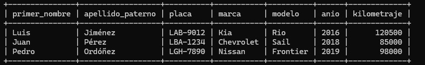

### Consulta 2

Obtener los nombres, apellidos y especialidades de los mecánicos, junto con las placas y modelos de los vehículos en cuyas órdenes de trabajo han participado.

**Álgebra Relacional:**

```
π nombre, apellido, especialidad, placa, modelo (mecanico ⋈ atiende ⋈ orden_trabajo ⋈ vehiculo)
```

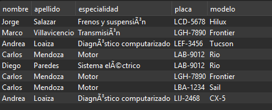

**SQL:**

```sql
SELECT m.nombre, m.apellido, m.especialidad, v.placa, v.modelo
FROM MECANICO m
JOIN ATIENDE a       ON a.id_mecanico = m.id_mecanico
JOIN ORDEN_TRABAJO o ON o.id_orden = a.id_orden
JOIN VEHICULO v      ON v.placa = o.placa;
```

Se obtiene un listado de cada mecánico con los vehículos de las órdenes en que participó. Solo se muestran 5 columnas: nombre, apellido, especialidad, placa y modelo. Salen 8 filas, una por cada participación de un mecánico en una orden. Un mismo mecánico puede repetirse con distintos vehículos (Carlos Mendoza aparece con LBA-1234, LAB-9012 y LGH-7890).

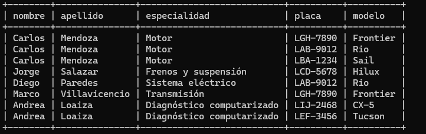

### Consulta 3

Obtener los clientes que poseen vehículos de marca Chevrolet o Toyota, mostrando sus nombres, apellidos y placas de sus vehículos.

**Álgebra Relacional:**

```
π primer_nombre, apellido_paterno, placa (σ marca == "Chevrolet" or marca == "Toyota" (cliente ⋈ vehiculo))
```

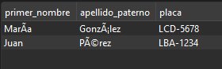

**SQL:**

```sql
SELECT c.primer_nombre, c.apellido_paterno, v.placa
FROM CLIENTE c
JOIN VEHICULO v ON v.id_cliente = c.id_cliente
WHERE v.marca = 'Chevrolet' OR v.marca = 'Toyota';
```

Se obtienen solo los clientes cuyo vehículo es Chevrolet o Toyota, mostrando únicamente 3 columnas (primer_nombre, apellido_paterno y placa).

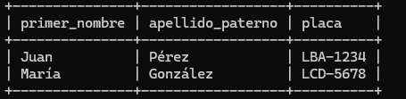

### Consulta 4

Identificar los mecánicos que han participado en órdenes de trabajo, pero que nunca han atendido órdenes cuyo estado sea EN_PROCESO.

**Álgebra Relacional:**

```
π id_mecanico, nombre, apellido, especialidad (((π id_mecanico (atiende)) - (π id_mecanico (atiende ⋈ σ estado == "EN_PROCESO" (orden_trabajo)))) ⋈ mecanico)
```

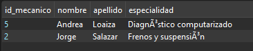

**SQL:**

```sql
SELECT m.id_mecanico, m.nombre, m.apellido, m.especialidad
FROM MECANICO m
WHERE m.id_mecanico IN (SELECT id_mecanico FROM ATIENDE)
AND m.id_mecanico NOT IN (
  SELECT a.id_mecanico
  FROM ATIENDE a
  JOIN ORDEN_TRABAJO o ON o.id_orden = a.id_orden
  WHERE o.estado = 'EN_PROCESO');
```

Se combinan las tablas ATIENDE, ORDEN_TRABAJO y MECANICO. Primero se toman todos los mecánicos que han participado en alguna orden, y luego se descartan los que participaron en órdenes EN_PROCESO (las órdenes 3 y 5, atendidas por los mecánicos 1, 3 y 4).

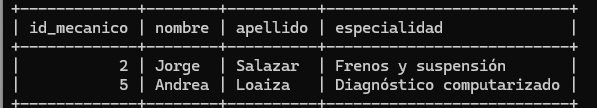

### Consulta 5

Identificar las órdenes de trabajo en las que se utilizaron todos los repuestos que suministra el proveedor "Lubricantes Andinos", mostrando el número de orden y la placa del vehículo.

**Álgebra Relacional:**

```
π id_orden, placa (((π id_orden, id_repuesto (repuesto_utilizado)) ÷ (π id_repuesto (σ id_proveedor == 4 (repuesto)))) ⋈ orden_trabajo)
```

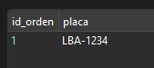

**SQL:**

```sql
SELECT o.id_orden, o.placa
FROM ORDEN_TRABAJO o
WHERE NOT EXISTS (
  SELECT 1
  FROM REPUESTO r
  WHERE r.id_proveedor = 4
  AND NOT EXISTS (
    SELECT 1
    FROM REPUESTO_UTILIZADO ru
    WHERE ru.id_orden = o.id_orden
    AND ru.id_repuesto = r.id_repuesto));
```

Se buscan las órdenes que usaron todos los repuestos del proveedor 4 (el filtro de aceite y el aceite 10W-40). Solo la orden 1 los usó a ambos; la orden 5 usó el aceite pero no el filtro, así que queda fuera.

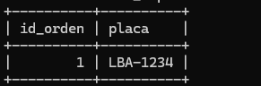

---

## CONCLUSIONES

- El modelado conceptual permitió pasar de la descripción del problema del taller a una estructura formal de entidades, atributos y relaciones. Al elaborar el diagrama E-R en notación Chen se comprendió que no todo dato es una entidad: el teléfono del cliente resultó ser un atributo multivalor, el total de la orden y el subtotal del detalle son atributos derivados que se calculan y no se almacenan, y Detalle de Servicio y Repuesto Utilizado dependen de la orden de trabajo, por lo que se modelaron como entidades débiles. La mayor dificultad estuvo en definir las cardinalidades, en especial la relación entre mecánicos y órdenes, que al ser de muchos a muchos exigió una tabla intermedia (ATIENDE) en el modelo relacional. Pasar del E-R al esquema relacional mostró que cada decisión de diseño se traduce en claves primarias, claves foráneas y tablas concretas, lo que cumple el primer objetivo específico.
- Escribir el código DDL y DML en MySQL permitió ver cómo el modelo se convierte en una base de datos que funciona. Las restricciones PRIMARY KEY y FOREIGN KEY garantizan la integridad referencial: no se puede registrar un vehículo de un cliente que no existe ni insertar datos en un orden incorrecto, por lo que las tablas padre se cargan antes que las hijas. Las restricciones NOT NULL, UNIQUE, DEFAULT y CHECK, como la que limita el estado de una orden a PENDIENTE, EN_PROCESO, FINALIZADO o ENTREGADO, llevan las reglas del taller a la base de datos y evitan datos inválidos desde el origen. También fue relevante elegir el tipo de dato adecuado, por ejemplo DECIMAL para los montos de dinero, y definir las acciones ON DELETE y ON UPDATE en cada clave foránea. Con esto se cumple el segundo objetivo específico.
- El álgebra relacional ayudó a plantear cada consulta paso a paso antes de escribirla en SQL: primero qué tablas se reúnen, luego qué filas se seleccionan y al final qué columnas se muestran. Cada operador tiene un equivalente directo: la selección corresponde a WHERE, la proyección a SELECT, la reunión natural a JOIN y la diferencia a NOT IN o NOT EXISTS. La división no tiene equivalente directo en MySQL y se resolvió con un doble NOT EXISTS, lo que hizo evidente la diferencia entre el álgebra formal y el lenguaje SQL. Las consultas más útiles para el taller fueron las que combinan varias tablas, como saber qué mecánico atendió qué vehículo, y las de diferencia y división, que permiten detectar casos como los mecánicos sin órdenes en proceso o las órdenes que usaron todos los repuestos de un proveedor. Probar las consultas con datos de ejemplo permitió comprobar que los resultados eran los esperados.


